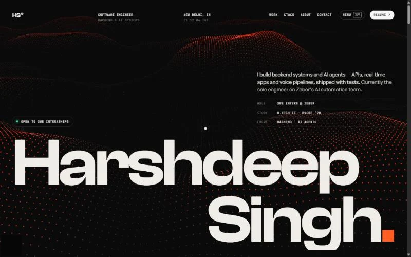
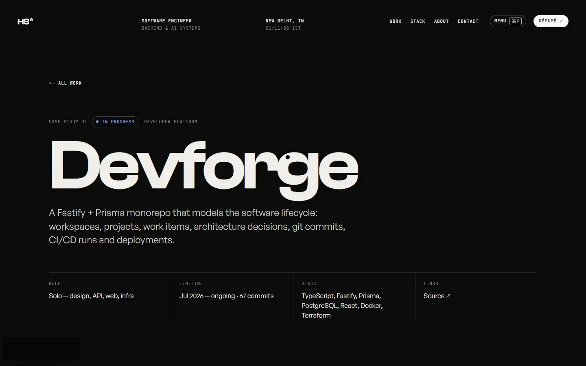

# Harshdeep Singh — portfolio

Backend and AI engineer. Technical intern at Neubitat, B.Tech IT at BVCOE (’28).

**[Live site](https://harshdeep-portfolio-tau.vercel.app)** · [Résumé](public/Harshdeep_Singh_Resume.pdf) · [LinkedIn](https://www.linkedin.com/in/harshdeep-singh-073b02320/) · [GitHub](https://github.com/harshdeepsingh888-ps)



## What's here

- **Home** — a WebGL hero, a pinned horizontal reel of five featured projects with real numbers (tests, routes, models), a node graph that wires each project to the stack it was built with, and experience written as a git log.
- **Case studies** — `/work/[slug]`, written in MDX: problem, architecture, decisions and trade-offs, what's next.
- **Project index** — `/work`, every project with filters and a hover preview.
- **⌘K / Ctrl+K** — a command menu to jump to any section or project, copy the email address or open the résumé.



## Stack

Next.js 16 (App Router, static generation) · React 19 · TypeScript · CSS Modules · three.js (custom GLSL shader) · GSAP + ScrollTrigger · Lenis · MDX · cmdk · `next/og` for social cards.

Performance and accessibility choices:

- three.js loads lazily, renders at most 2× DPR, uses fewer particles on phones, and stops rendering once the hero is off-screen.
- `prefers-reduced-motion` turns off smooth scrolling, the intro, the pinned reel and the particle animation (one still frame is drawn instead).
- All content is server-rendered HTML; animation is progressive. If scripts fail, the intro hides itself after a few seconds.
- Images are WebP, served through `next/image`.

## Editing content

Everything lives in `src/content`:

| File | What it controls |
| --- | --- |
| `site.ts` | Name, links, hero copy, stats, the About statement, the experience log |
| `projects.ts` | Every project: summary, metrics, stack, links, cover image, and the skills used by the stack graph |
| `case-studies/*.mdx` | Long-form case studies (one per project with `caseStudy: true`) |

Adding a project means one new object in `projects.ts`, plus an `.mdx` file if it gets a case study.

## Running locally

```bash
npm install
npm run dev
```

```bash
npm run build && npm start
```

Requires Node.js 20.9+. Deployed on Vercel; every push to `main` deploys.
